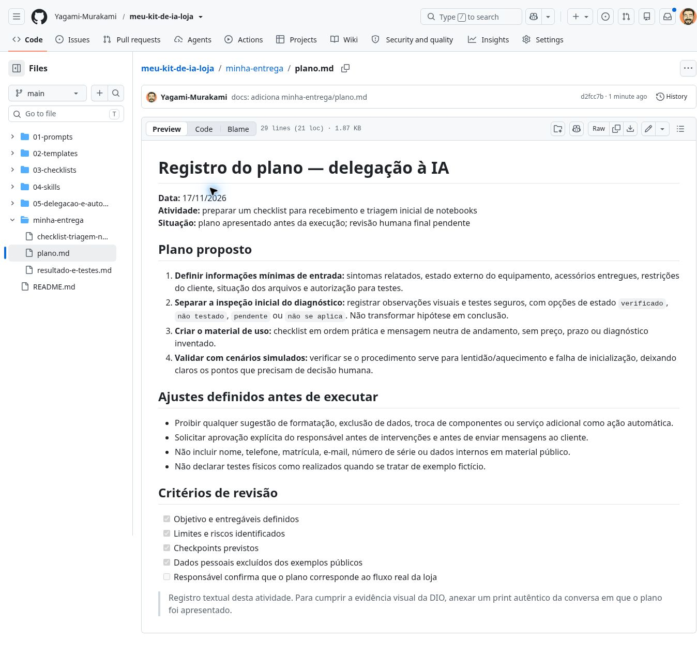
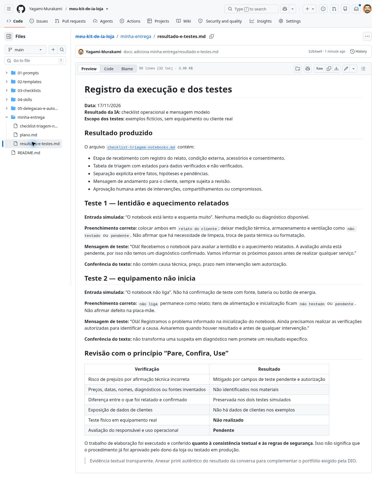

# Meu Kit de IA

Desafio de Projeto da [DIO](https://dio.me): monte o seu kit de IA para o dia a dia e delegue uma tarefa real, com você no comando.

O kit foi criado pelo Expert Bruno Lima com os prompts, templates, checklists e skills usados nas Aulas. Ele não é uma apostila: abra a pasta que resolve o seu problema, copie o modelo, adapte e use.

**Copie → adapte → teste → confira → melhore**

## Como Fazer o Desafio

Você não precisa instalar nada nem saber programar. Tudo acontece no navegador.

1. Clique em **Use this template**, depois em **Create a new repository**. Dê um nome simples, como `meu-kit-de-ia`, deixe **Public** e confirme.
2. Siga os passos abaixo com uma tarefa real da sua semana.
3. Preencha a seção [Minha Entrega](#minha-entrega) da sua cópia e entregue o link dela na DIO.

## Os Passos

1. **Escolha uma tarefa real.** Comece pelo trabalho que se repete na sua semana, como preparar uma reunião ou montar um relatório, e não pela ferramenta.
2. **Pegue um modelo.** Abra a pasta do kit que combina com a sua tarefa. Cada modelo tem um botão de copiar no canto.
3. **Adapte.** Troque o que está entre colchetes pelo seu contexto, objetivo, dados, limites e formato.
4. **Teste.** A primeira resposta é um ponto de partida. Ajuste até funcionar para a sua realidade.
5. **Delegue.** Com o [template de delegação](02-templates/03-delegacao.md), entregue a tarefa à IA. Peça o plano antes de ela começar, acompanhe e valide o resultado.
6. **Confira.** Provável não é o mesmo que verdadeiro. Revise com o [Pare, Confira, Use](03-checklists/01-pare-confira-use.md) antes de usar.

## O Que Tem no Kit

| Pasta | Para que serve |
|---|---|
| [01-prompts](01-prompts) | Pedidos prontos para adaptar: escrita, comunicação, pesquisa, comparação e preparação de reuniões |
| [02-templates](02-templates) | Estruturas para preencher: bom pedido, pesquisa e decisão, e delegação |
| [03-checklists](03-checklists) | Revisão de respostas, de textos e de tarefas delegadas |
| [04-skills](04-skills) | Como criar uma skill, e a Skill Preparador de Reuniões usada nas Aulas |
| [05-delegacao-e-automacao](05-delegacao-e-automacao) | Gatilhos de automação, supervisão e checkpoints |

## Os Frameworks das Aulas

- **Bom pedido:** contexto + instrução + objetivo + formato. Quanto menos a IA precisa adivinhar, melhor você consegue avaliar a resposta.
- **Pesquisa e decisão:** pergunta → pesquisa → critérios → comparação → você. Peça fontes quando precisar de informação externa. A decisão final é sua.
- **Segurança:** pare → confira → use. Valide fatos, números, datas, fontes e contexto.
- **Atalhos reutilizáveis:** criar → testar → ajustar → salvar. Separe as instruções fixas das informações que mudam a cada uso.
- **Delegação:** objetivo + contexto + recursos + limites + sucesso. Autonomia funciona melhor quando o resultado esperado está claro.
- **Supervisão:** definir → delegar → acompanhar → validar. Em tarefas maiores, confira o plano, acompanhe os checkpoints e valide o resultado.

> A IA pode ajudar você a escrever, pesquisar, organizar e executar. A responsabilidade pelo resultado continua sendo sua.

---

## Minha Entrega

Desafio desenvolvido em 17/11/2026, a partir de uma rotina de uma pequena loja de informática. O material abaixo usa apenas exemplos genéricos, sem identificar clientes nem expor dados de atendimento.

### Minha Tarefa Real

**Tarefa escolhida:** organizar um procedimento reutilizável de recebimento e triagem inicial de notebooks e preparar mensagens claras para informar o andamento da avaliação.

Essa rotina se repete em serviços de manutenção. Um checklist consistente ajuda a registrar sintomas, deixar explícito o que ainda não foi testado e evitar prometer uma solução antes do diagnóstico. O resultado é um material de trabalho real, mas os exemplos de teste usados aqui são fictícios e anônimos.

### Meus Atalhos

Adaptei dois modelos da pasta [`01-prompts`](01-prompts): [escrever e melhorar textos](01-prompts/01-escrever-e-melhorar-textos.md) e [adaptar comunicação](01-prompts/02-adaptar-comunicacao.md).

**Fixo:** linguagem simples, tom profissional e humano, formato de mensagem curta e proibição de inventar orçamento, prazo ou diagnóstico. **Variável:** relato do atendimento, estágio da avaliação, testes realizados e próxima etapa autorizada.

**Atalho 1 — Mensagem de andamento para WhatsApp:**

```text
CONTEXTO
Atendo clientes de manutenção de notebooks em uma pequena loja de informática.

INSTRUÇÃO
Reescreva os fatos do atendimento em uma mensagem objetiva para WhatsApp.

OBJETIVO
Explicar ao cliente o estado atual do serviço, sem causar confusão.

FORMATO
Até 4 frases, em português do Brasil, tom educado e natural.

REGRAS FIXAS
Não invente diagnóstico, preço, data, prazo, teste ou garantia.
Se algo ainda não foi verificado, diga isso claramente.
Não inclua dados pessoais do cliente.
Não apresente uma intervenção como autorizada sem essa informação.

CONTEÚDO BASE (MUDAR A CADA USO)
[fatos verificados e etapa atual do atendimento, sem dados pessoais]
```

**Teste do atalho 1:** entrada de exemplo: “Notebook recebido para avaliar lentidão; diagnóstico ainda não realizado.” Saída revisada: “Olá! Recebemos o notebook para avaliar a lentidão relatada. O diagnóstico ainda não foi realizado. Assim que tivermos uma conclusão, informaremos os próximos passos antes de qualquer serviço.” O texto não acrescenta valor nem prazo.

**Atalho 2 — Traduzir anotação técnica para o cliente:**

```text
Tenho uma anotação técnica sobre um notebook e preciso explicá-la
para uma pessoa sem conhecimento de informática.

Adapte a linguagem, o nível de detalhe e o formato.
Objetivo: explicar o que foi observado e o que ainda depende de teste.
Tom: simples, respeitoso e sem alarmismo.
Formato: mensagem curta em português do Brasil.

REGRAS FIXAS
Mantenha o significado dos fatos.
Separe observação confirmada de hipótese e de teste pendente.
Não invente causa, conserto, preço ou prazo.
Não recomende apagar arquivos, formatar ou trocar peças sem autorização.

CONTEÚDO ORIGINAL (MUDAR A CADA USO)
[anotação técnica anonimizada]
```

**Teste do atalho 2:** entrada de exemplo: “Inicialização lenta; teste de armazenamento pendente.” Saída revisada: “O notebook está demorando para iniciar. Ainda precisamos verificar o armazenamento para entender a causa. Não há diagnóstico confirmado neste momento.” Mantida a diferença entre fato e hipótese.

### Minha Delegação

```text
OBJETIVO
Criar um checklist prático de recebimento e triagem inicial de notebooks,
com uma mensagem padrão para informar ao cliente que a avaliação está em andamento.

CONTEXTO
O material será usado em uma pequena loja que recebe notebooks para
avaliar lentidão, aquecimento, falha de inicialização e outros sintomas.
Preciso de um procedimento curto e repetível, para não esquecer informações.

RECURSOS
Use os modelos deste kit, práticas gerais de documentação técnica
e somente as informações deste pedido. Use casos fictícios para testes.

LIMITES
Não acesse equipamentos, sistemas, contas nem dados de clientes.
Não invente medições, resultados de diagnóstico, preços ou prazos.
Não execute formatação, exclusão, backup, troca de peças ou comunicação
com terceiros. Destaque decisões que exigem minha autorização.

SUCESSO
Entregar checklist organizado por etapas, com campos claros para
"verificado", "não testado" e "pendente", além de uma mensagem padrão.
Testar o checklist contra dois cenários fictícios e apontar lacunas.
O material só será colocado em uso depois da minha revisão.

Antes de começar, mostre como pretende realizar essa tarefa.
```

### O Plano da IA

A IA apresentou o plano em quatro etapas: (1) mapear os dados mínimos de entrada, (2) organizar verificações seguras e estados do diagnóstico, (3) redigir a mensagem e (4) simular dois cenários e conferir limites.

**Ajuste antes da execução:** acrescentei a exigência de não sugerir formatação, exclusão ou troca de peças sem consentimento e de separar observações de hipóteses. Registro detalhado: [`minha-entrega/plano.md`](minha-entrega/plano.md).

**Captura do plano publicado no GitHub:** a imagem abaixo é um print real do registro de planejamento, depois de salvo. Ela é uma evidência complementar, **não** um print da conversa com a IA. O print da conversa ainda precisa ser anexado antes da submissão na DIO.



### O Resultado

Foram produzidos: [checklist operacional](minha-entrega/checklist-triagem-notebooks.md) e [registro dos testes e da revisão](minha-entrega/resultado-e-testes.md).

**Conferência preliminar:** o checklist distingue o que foi relatado do que foi observado, oferece estados para testes não realizados e exige aprovação antes de procedimentos que alterem arquivos ou componentes. Nos dois cenários fictícios, as mensagens não afirmam causa ou prazo desconhecidos. Não houve teste físico em notebook real nesta etapa.

**Captura do resultado publicado no GitHub:** a imagem abaixo mostra o registro dos testes, como foi salvo. É uma evidência complementar, **não** um print da conversa com a IA. O print da conversa ainda precisa ser anexado antes da submissão na DIO.



**Validação final pelo responsável da loja:** pendente; não apresentar esta revisão preliminar como homologação em uso.

### Como Foi para Você

Nesta primeira execução, o kit transformou uma tarefa recorrente em dois prompts reutilizáveis e um procedimento que pode ser conferido antes do uso. Ficou mais fácil visualizar quais informações mudam a cada atendimento e quais decisões precisam continuar sob controle humano. O impacto na rotina real será avaliado após testar e aprovar o material na loja.
